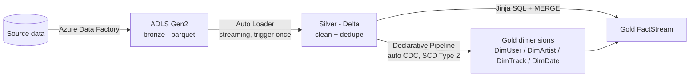

# Spotify Metadata Pipeline (Azure + Databricks)

An end-to-end data engineering project on Azure. Spotify-style metadata (users, artists, tracks, dates, streams) moves through a **medallion architecture** — bronze, silver, gold — and is deployed as a Databricks Asset Bundle.

## Architecture



| Layer | Where | What happens |
|-------|-------|--------------|
| Bronze | ADLS Gen2 container `bronze` | Raw parquet files landed by Azure Data Factory |
| Silver | `src/silver/silver_dimension.py` | Auto Loader reads each table, drops `_rescued_data`, dedupes users/artists, labels track length (`durationFlag`), cleans track names, writes Delta tables to `spotify_catalog.silver` |
| Gold dimensions | `src/gold/gold_dimensions.py` | Declarative pipeline: SCD Type 2 history for `DimUser`, `DimArtist`, `DimTrack`; `DimDate` as a materialized view |
| Gold fact | `src/jinja/gold_fact_stream.py` | Jinja builds the join SQL against current dimension rows; `MERGE` into `gold.FactStream` |

The job in `spotify_azure/resources/spotify_azure.job.yml` runs silver, then the gold pipeline, then the fact notebook, daily.

## Repo layout

```
spotify_azure/
  databricks.yml            bundle config (dev / prod targets)
  resources/                job + pipeline definitions
  src/silver/               silver notebook
  src/gold/                 gold dimensions (declarative pipeline)
  src/jinja/                gold fact notebook
  utils/                    shared helpers (DataFrame helper, Jinja query builder)
  tests/                    unit tests (no Spark needed)
```

## Setup

1. **Azure**: storage account (ADLS Gen2, hierarchical namespace) with containers `bronze` and `silver`; an Azure Databricks workspace with Unity Catalog; an external location + credential for the storage account; Azure Data Factory copying source tables into `bronze/<TableName>/` as parquet.
2. **Unity Catalog**: create catalog `spotify_catalog` with schemas `silver` and `gold`.
3. **Config**: set your workspace `host` in `spotify_azure/databricks.yml`. The storage account name (`viviazure`) is in `src/silver/silver_dimension.py`; change it to yours.
4. **Deploy**:
   ```bash
   cd spotify_azure
   databricks bundle validate
   databricks bundle deploy --target dev
   databricks bundle run spotify_azure_job
   ```
5. **Tests**: `pip install pytest jinja2 pyyaml && pytest`

## Things to check before running

- `src/jinja/gold_fact_stream.py` assumes `FactStream` has `stream_id`, `user_id`, `track_id`, and that the dimension columns listed in `DIMS` exist. Edit those lists to match your schema.
- `gold_dimensions.py` assumes each SCD2 dimension has an `updated_at` column to order changes.
- Silver checkpoint paths are kept as originally run. `DimTrack` is a managed table; the others write to explicit paths in the `silver` container.

## Tech

Azure Data Factory, ADLS Gen2, Azure Databricks, Auto Loader, Delta Lake, Unity Catalog, Lakeflow Declarative Pipelines, Jinja2, Databricks Asset Bundles, PySpark.
# azure-project
